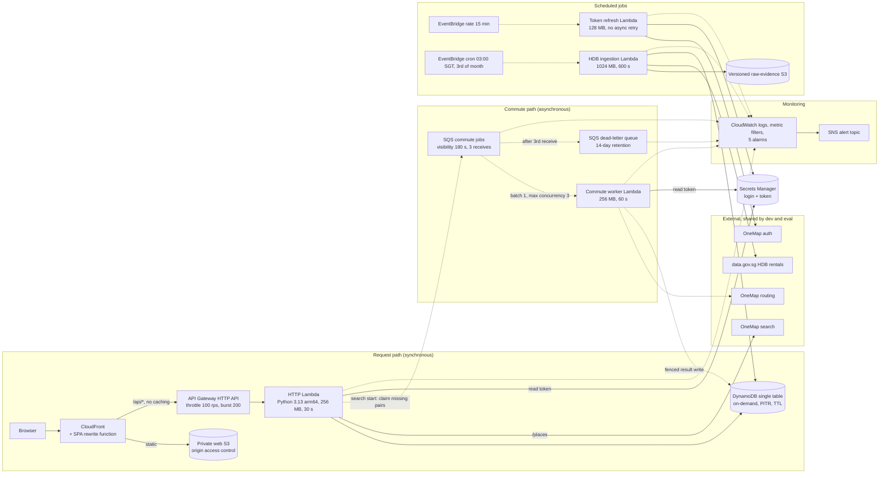

# Deployed architecture and evaluation map (#36)

**Issue:** [#36 — Complete architecture and performance evaluation](https://github.com/horiiiiii032929/CS5225-teams12-2026/issues/36) · **Owner:** Shyam · **Reviewer:** WK · **Drafted:** 8 November 2026 (SGT)

This page gives the component figure for the evaluated deployment, which paths are synchronous and which are not, and what dev and eval share. It also lists which evidence supports each evaluation claim in the [final report](../../report/final-report-draft.md). It adds no new measurement of latency or capacity.

## Which revision this describes

| Item                | Value                                                                                                                                                                                                                                                                                  |
| ------------------- | -------------------------------------------------------------------------------------------------------------------------------------------------------------------------------------------------------------------------------------------------------------------------------------- |
| Evaluated stack     | `FlatSplit-eval`, account `553455762180`, `ap-southeast-1`                                                                                                                                                                                                                             |
| Deployed source     | `e2d3780e28028574f8ee3dd990c10257be9f8029`, created 4 Nov 2026 17:43 SGT ([#72](https://github.com/horiiiiii032929/CS5225-teams12-2026/issues/72))                                                                                                                                     |
| Figure derived from | The CDK app (`infra/aws/src`) synthesised for `eval`. `git diff e2d3780 7e1006e -- infra services packages` is empty, so the template is the one deployed. `main` differs from the deployment only in `apps/web` (`MemberPreferencesForm`, #100), which changes no component here.     |
| Deployed read-back  | [`raw/2026-11-08/readback.txt`](raw/2026-11-08/readback.txt), captured 8 Nov 2026 19:35 SGT with the read-only [`scripts/readback.sh`](scripts/readback.sh). The stack is `CREATE_COMPLETE` with no update since 4 Nov, and its resource-type counts equal the synthesised template's. |

## Component figure

Solid arrows are the synchronous request path: the browser waits for a response. Dashed arrows are asynchronous. Dotted arrows are scheduled or monitoring paths.

### What a request waits for and what it doesn't

- **Synchronous:**
  - Group create, join, read and preference save.
  - Destination lookup (`/places`). This is the only synchronous call to an outside service, OneMap search.
  - Search submission.
  - Search status polls.
- **Search submission does not wait for routes.** It pins the group revision, rent snapshot and routing profile, then reuses cached station-town commutes. Each missing pair gets a conditional claim and one SQS message. The response returns without waiting for those pairs. The browser then polls every 2 seconds, and status is derived when it's read, so there is no fan-in counter.
- **The worker runs off the request path.** It processes one message per invocation, at most three at a time. Its result write requires a matching `jobId` and `pending` status, so a duplicate, late or injected message writes nothing. Failures are retried only by SQS redelivery (180 s apart, three receives, then the DLQ). The worker has no retry loop of its own.
- **Scheduled jobs touch the request path only through stored data.** Token refresh writes the token secret, which the HTTP Lambda and the worker read. Ingestion writes immutable rent snapshots before advancing `RENT/CURRENT`.

### Components and deployed settings

Settings come from the synthesised `eval` template. The "Read back" column records what the 8 Nov read-back confirmed; anything it did not query is marked as not read.

| Component            | Setting that matters for evaluation                                                                                     | Read back                                           |
| -------------------- | ----------------------------------------------------------------------------------------------------------------------- | --------------------------------------------------- |
| CloudFront           | One origin for web and `/api/*`; API not cached; SPA rewrite in a CloudFront Function                                   | present (cache settings not read)                   |
| API Gateway HTTP API | `$default` stage, rate 100 rps, burst 200                                                                               | matches                                             |
| HTTP Lambda          | One function for all routes, Python 3.13 arm64, 256 MB, 30 s; no reserved concurrency                                   | matches                                             |
| DynamoDB             | One table, on-demand, point-in-time recovery on, TTL on `ttl`; no GSIs                                                  | billing, PITR match (TTL not read)                  |
| SQS jobs → worker    | Visibility 180 s, `maxReceiveCount` 3, retention 4 days; batch 1, `MaximumConcurrency` 3, partial-batch failure         | matches; 0/0 messages                               |
| DLQ                  | Retention 14 days; `CommuteDlqNotEmpty` at ≥ 1 visible message                                                          | matches; 0 messages, alarm OK                       |
| Call budget          | `RATE#ONEMAP` counter in the stage's table: 250 calls/min in total, of which the worker may take 200                    | n/a (code)                                          |
| Token refresh        | `rate(15 minutes)`, 128 MB, 0 async retries; alarms `OneMapTokenRefreshFailing` and `OneMapTokenExpiring`               | matches (async retry not read)                      |
| Rent ingestion       | `cron(0 19 2 * ? *)` UTC (03:00 SGT on the 3rd), 1024 MB, 600 s; raw files in a versioned bucket; `RentIngestionFailed` | matches (bucket versioning not read)                |
| Alarms → SNS         | 5 alarms, each with one SNS action. The template has no subscription unless a budget email is supplied at deploy time   | **0 subscriptions**; all 5 alarms OK, 1 action each |

### What dev and eval share

The two stacks have separate tables, queues, functions, buckets, secrets and alarms. They do share these:

- **The AWS account and region.** Account-level Lambda concurrency and service quotas apply to both stages together.
- **One OneMap team account, and so one token.** Since #72 both stages log in with the same team account, and OneMap gives both the same token. On 7 Nov dev picked up the new token 50 s after expiry and eval 3 min 23 s after.
- **The OneMap call budget is counted per stage, not per account.** Each stage keeps its own `RATE#ONEMAP` counter. Dev and eval can each spend up to 250 calls/min, which together exceeds OneMap's published 300/min for what is one account. The budget only holds while one stage generates the OneMap traffic. This is why routing-heavy work (warm-ups, drills) has been run on one stage at a time. W1 and W2 read cached results and make no routing calls.
- **data.gov.sg** is the rental source for both stages' monthly ingestion.

## Evaluation evidence map

The report's evaluation table summarises these results. This map gives the evidence behind each one and its limit. "Deployed" means measured on an AWS stack; anything else is labelled as local or modelled.

| Claim                                            | Evidence                                                                                                                              | Kind                         | Limit                                                                                                                                               |
| ------------------------------------------------ | ------------------------------------------------------------------------------------------------------------------------------------- | ---------------------------- | --------------------------------------------------------------------------------------------------------------------------------------------------- |
| Rental numbers are faithful to HDB               | [E8 rent audit](../e8/), [#20](https://github.com/horiiiiii032929/CS5225-teams12-2026/issues/20)                                      | Source audit + deployed data | HDB against HDB; snapshot periods differ                                                                                                            |
| Every routable pair resolves; TENGAH is explicit | [E8 deployed reconciliation](../e8/), [#19](https://github.com/horiiiiii032929/CS5225-teams12-2026/issues/19#issuecomment-6704556686) | Deployed (`eval`)            | Station-to-station; one weekday departure; OUTRAM_PARK ±5.7 min                                                                                     |
| Station snapping understates door-to-door time   | [E8 snapping comparison](../e8/), [#34](https://github.com/horiiiiii032929/CS5225-teams12-2026/issues/34)                             | Live OneMap audit            | Three probe towns, not a random sample                                                                                                              |
| Failures are bounded and visible                 | [E5 drill](../e5/), [#27](https://github.com/horiiiiii032929/CS5225-teams12-2026/issues/27)                                           | Deployed (`eval`)            | Permanent failure only; no transient OneMap outage induced; token alarm not triggered on purpose                                                    |
| An operator who didn't build it can run it       | [Runbook walkthrough](https://github.com/horiiiiii032929/CS5225-teams12-2026/issues/33)                                               | Deployed (`eval`)            | One teammate, one failure case                                                                                                                      |
| Token rollover is automatic                      | [#72 rollover receipt](https://github.com/horiiiiii032929/CS5225-teams12-2026/issues/72#issuecomment-6704569111)                      | Deployed (dev + eval)        | One rollover, nobody using the API during the gap                                                                                                   |
| Worker throughput is bounded by the budget       | [Queue drain](../worker-queue/), [warm-up](https://github.com/horiiiiii032929/CS5225-teams12-2026/issues/30): 702 calls at ~125/min   | Emulated AWS + deployed      | Budget refusal at the 200/min ceiling not observed on AWS                                                                                           |
| Warm-result p95 < 500 ms; sustained throughput   | [#30](https://github.com/horiiiiii032929/CS5225-teams12-2026/issues/30)                                                               | **Not measured yet**         | Next monitored window 9 Nov 10:00–12:00 SGT. Without an accepted run this stays a stated limitation. The local 501-VU pilot is client evidence only |
| Hosting cost                                     | [E9 cost model](../e9/), [#45](https://github.com/horiiiiii032929/CS5225-teams12-2026/issues/45)                                      | Measured usage + model       | Modelled, not billed; B/C node capacity assumed. Serverless throughput is not `sustained_rps_per_node`                                              |
| Reliability and security                         | [#35](https://github.com/horiiiiii032929/CS5225-teams12-2026/issues/35)                                                               | Partial                      | Qualification recorded as partial                                                                                                                   |

## Corrections for the report's figure (§2.2)

The report's component paths match this figure, with four omissions. I'm listing them here rather than editing the report, because the report's PDF renderer draws its own layout of that figure:

1. Token refresh also calls **OneMap auth**, and OneMap is shared with dev.
2. Alarms notify through an **SNS topic**, and on `eval` that topic has **no subscriptions** (8 Nov read-back). An alarm's state change is therefore visible in CloudWatch, but nobody is notified. The E5 drill observed the alarm state, not a notification, so the report should claim visibility, not alerting.
3. Secrets Manager holds **two secrets**: the account login, which only token refresh can read, and the token, which the HTTP Lambda, the worker and token refresh can read.
4. §2.2 could add one sentence saying the OneMap call budget is counted per stage, so the 250/min guard assumes one stage generates the OneMap traffic at a time.
