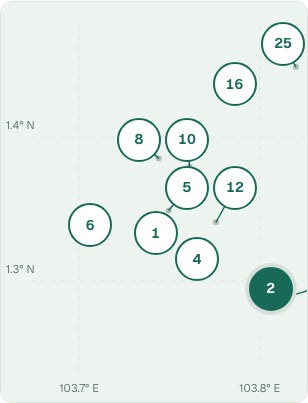
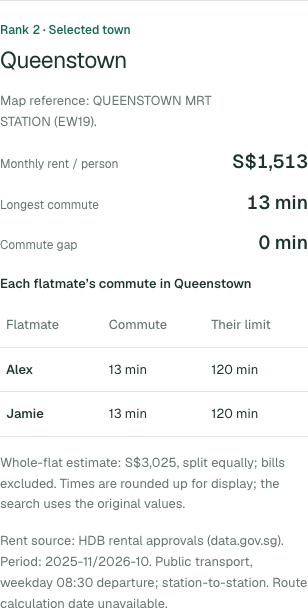
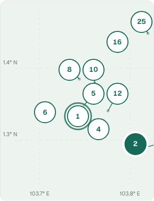
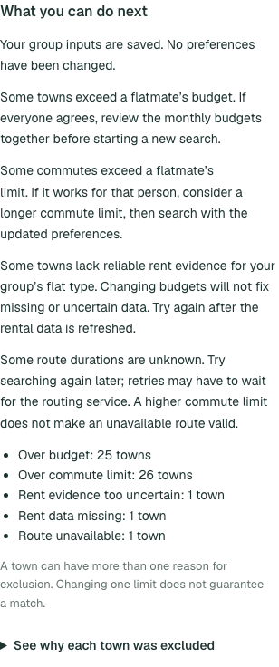
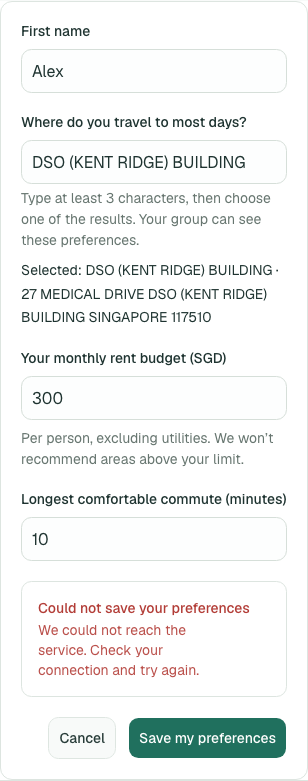
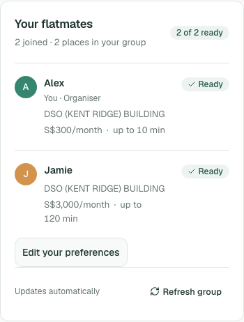
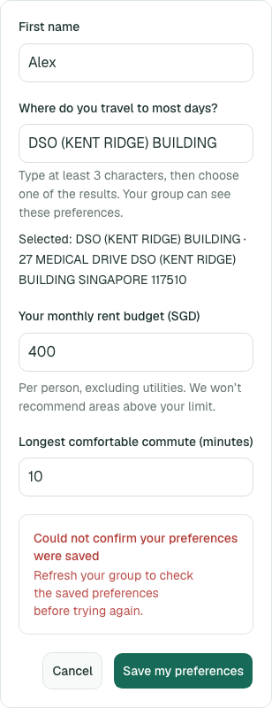

# Deployed browser acceptance — 8 November 2026

Browser executor: **GPT-6.1 Terra**. Target: [FlatSplit dev](https://d2g88qlwvm8dec.cloudfront.net/).
Viewports: 390 × 844 and 1280 × 900, independent Chromium contexts, synthetic QA members.
Observed assets: `index-Bx9Ir7cN.js`, `link-DgDoZIkL.js`, `index-D6Yp-8nJ.css`; these identify observed assets, not an attested runtime commit.

| Issue                                | Verdict                             | Evidence                                                                                                                                                                                                     |
| ------------------------------------ | ----------------------------------- | ------------------------------------------------------------------------------------------------------------------------------------------------------------------------------------------------------------ |
| #24 map and accessible details       | **PASS on the existing deployment** | Two-/five-member pointer and keyboard journeys; corrected desktop runs; real member-ID-to-response mapping; visible Tab focus; no document overflow; zero tagged Axe WCAG A/AA violations at checked results |
| #26 empty/status recovery            | **Scoped passes**                   | Real empty-result guidance; client-scoped loading, 503 and 35-second timeout with action/recovery                                                                                                            |
| #26 ambiguous preference save        | **Deployed defect, locally fixed**  | Committed HTTP 200 followed by browser-dropped response showed a misleading save failure; fixed local frontend confirms server state or preserves edits with uncertainty                                     |
| #26 deployed fixed-client acceptance | **Pending**                         | Operator deployment of the reviewed fix and GPT-6.1 Terra deployed retest                                                                                                                                    |

## Evidence

- [Full run report and reproducible procedure](terra-run-report.md)
- [Two-/five-member initial results](results.json), [corrected two-member pointer result and real empty case](controlled-results.json), [corrected five-member desktop result](five-corrected.json)
- [Distinct member outcomes](member-mapping.json): selected Serangoon mapped Alex to 28 displayed minutes and Jamie to 23, joined by member identity
- [Keyboard/status/loading/timeout observations](recovery-conditions.json)
- [Controlled route retry action](controlled-route-retry.json)
- [Fixed local frontend browser result](local-fix-results.json)
- [Complete sanitized Drive bundle](https://drive.google.com/drive/folders/1VgWzJQs0QChn0wOE3az45GcWMPjS7MJH): additional screenshots and portable scripts. Public-link permission is pending an account step; GitHub copies here remain available to repository readers.

## Map/details proof

## Empty and save recovery proof

The last two images show local frontend code connected to the live API. They are not a deployed-fix claim.

## Fix and validation

Fix source commit: `50505dfb4e28279934d75de07d208a376e89fdb4`.
[PR #100](https://github.com/horiiiiii032929/CS5225-teams12-2026/pull/100) cancels an older group read and checks authoritative member values after ambiguous transport/5xx save outcomes. It confirms matching values; otherwise it retains the draft and explicit uncertainty.

Terra's 113 web tests, web lint/typecheck, build and local browser retest passed. Repository [CI on the source fix](https://github.com/horiiiiii032929/CS5225-teams12-2026/actions/runs/42396029776) also passed API-generation drift, root checks/tests/build and CDK synthesis.

## Remaining handoff

Hikaru/Lucy can use this #24 evidence in #25's broader release checklist. #26 stays open until the fixed frontend is deployed and its saved/uncertain cases are rerun against that build. The current local AWS session returned `ExpiredToken`; OneMap destination lookup itself worked. Keep credentials out of the handoff.

For Mani's report, retain these limits:

- Browser-intercepted delays/errors and a transformed all-unavailable response establish client behavior, not an AWS/OneMap outage, eligible backend retry or provider recovery.
- Initial desktop repeated-pin assertions and programmatic-focus observations were test setup issues; the corrected pointer and actual Tab-focus checks are separately retained.
- Axe checks are bounded engineering evidence, not complete accessibility certification or a physical-device/screen-reader study.
- This automation creates no human participant outcomes for #31.
