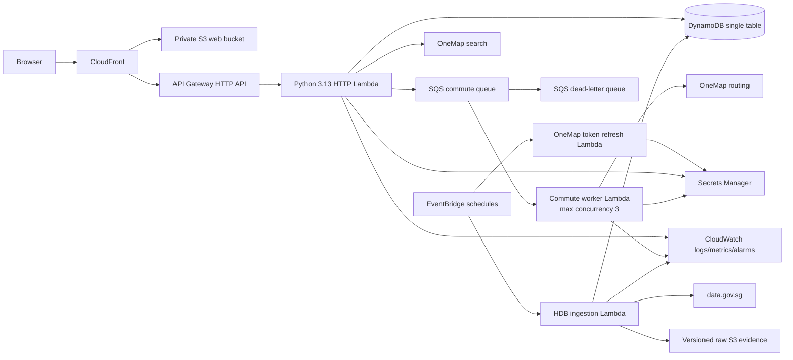

# FlatSplit: Evidence-Backed Group Rental Search

**CS5224 Cloud Computing - Group 12**

**Final report - 12 November 2026 (SGT)**

**Group 12 submission report for issue [#38](https://github.com/horiiiiii032929/CS5225-teams12-2026/issues/38)**

| Team member               | Project identity            |
| ------------------------- | --------------------------- |
| Dong Langqing             | Lucy / `@Raccoon33`         |
| Horinouchi Hikaru (Rawin) | Hikaru / `@horiiiiii032929` |
| Hsieh Ming Cheng          | Ming / `@lukerspace`        |
| Ku Wee Kiat               | WK / `@wkkuu`               |
| Ramalingam Saravanamani   | Mani / `@saravanamani1999`  |
| Shyam Ganesh Jayagopi     | Shyam / `@shyamgj1900`      |

> **Evidence scope.** This report distinguishes deployed measurements, local
> tests and modelled results. The participant study was not run before the
> reporting cut-off. Reliability qualification is partial: bounded failure and
> operational inspection were demonstrated, while transient provider recovery,
> saturation enforcement, PITR restoration and several live security checks
> remain unmeasured.

## Abstract

FlatSplit is a serverless web service for groups of two to five people choosing
an HDB rental town in Singapore. Existing rental portals optimise for an
individual listing search; they do not combine every housemate's budget,
destination and maximum commute into one explainable group decision. FlatSplit
uses official HDB rental data and OneMap public-transport routes to filter
infeasible towns and rank the remainder by rent per person, average commute and
commute inequality. The implementation uses CloudFront, S3, API Gateway,
Lambda, DynamoDB, SQS, EventBridge, Secrets Manager and CloudWatch. Its central
cloud design choice is to keep interactive requests short while moving
provider-bound routing and monthly data publication into asynchronous,
bounded workflows.

The evidence supports the core data and reliability claims. A rental audit
matched 65 of 72 numeric HDB quarterly medians exactly; median absolute error
was S$0 and maximum error was S$100 (2.70%). A reviewed route audit covered
810 town-destination pairs: all 780 routable pairs succeeded and 30 TENGAH
pairs were explicitly unavailable rather than represented as zero minutes. A
deployed drill showed three bounded deliveries followed by dead-lettering and
a CloudWatch alarm. The cost model estimates typical serverless cost at
US$0.96/month under assumed allowances, against US$5.71 at list price,
US$243.50 for self-managed on-premise hosting, and US$85.94 for a
university-hosted VM. However, the cost figures are modelled rather than billed,
station snapping systematically understates door-to-door commutes, and deployed
transient recovery was not induced. An accepted warm-cache run completed
1,200/1,200 reads at two requests/s with client p50/p95/p99 of 382/457/505 ms,
meeting the 500 ms warm p95 objective in that run. No operator monitored the
run live; its CloudWatch reconciliation was retrospective. Cold latency,
cold-start share, sustained throughput and maximum capacity remain unmeasured.
The prepared participant study was not run before the reporting cut-off, so no
participant outcome is claimed.

## 1. Motivation and Business Case

Singapore students and young professionals often share an HDB flat to reduce
housing cost. The difficult decision is not merely which listing is cheapest,
but which town is acceptable to the whole group. Housemates may work or study
at different destinations, have different budgets, and tolerate different
commute lengths. An apparently good average can conceal one member's
unacceptable journey.

FlatSplit addresses that coordination problem at town level. Each member owns
their destination, monthly budget and maximum commute input. Once every member
is ready, the service returns feasible towns, per-person rental benchmarks,
each member's estimated commute, the longest journey and the gap between the
shortest and longest journeys. Excluded towns remain visible with specific
reasons such as over budget, over commute, low-confidence rent or unavailable
route. The prototype does not provide individual listings, room allocation,
eligibility advice, payments, bookings or a guarantee that a flat is available
at the benchmark price.

### 1.1 Target users and value proposition

- **Primary users:** groups of two to five students or young working adults
  renting together in Singapore.
- **Problem solved:** combine multiple personal constraints into one
  reproducible, explainable comparison instead of coordinating through
  screenshots and repeated messages.
- **Differentiation:** existing portals search listings; FlatSplit compares
  group-level town trade-offs and exposes the most burdened member rather than
  hiding them inside an average.
- **Potential customers:** university communities, relocation services and
  property professionals supporting shared households.

### 1.2 Business model

The prototype is a free decision-support service. A future freemium product
could charge for saved searches, rental trend alerts, scenario history or
professional comparison reports. Distribution could use university housing
communities, referrals and relocation partnerships. These revenue features are
not implemented and are not needed to validate the technical proposition.

The workload is seasonal and bursty: searches cluster around semester and
relocation periods, while the service may be almost idle between them. This
favours request-priced serverless components over continuously running
capacity. The corrected cost model compares four like-for-like options:

| Hosting option                   | Quiet US$/month | Typical US$/month | Bursty US$/month | Important boundary                                                           |
| -------------------------------- | --------------: | ----------------: | ---------------: | ---------------------------------------------------------------------------- |
| AWS serverless, modelled payable |            0.82 |          **0.96** |         **2.09** | Assumed allowances; not an observed bill                                     |
| AWS serverless, list price       |            5.11 |          **5.71** |        **10.45** | Free-tier credits removed                                                    |
| AWS always-on VM                 |           38.32 |         **38.44** |        **56.92** | 2 nodes quiet/typical, 3 bursty; capacity assumed                            |
| Self-managed on-premise          |          243.50 |        **243.50** |       **274.87** | Range US$188.81-415.38 (bursty US$220.18-446.74); 2 nodes (3 bursty) assumed |
| University-hosted VM             |           85.94 |         **85.94** |        **85.94** | Range US$31.25-257.81; fixed allocation, not capacity-sized                  |

At typical demand, modelled payable serverless cost is about 90 times lower than
the university-hosted VM estimate (US$0.96 versus US$85.94). Serverless list price
is about 43 times lower than the self-managed on-premise estimate. A truly idle
month is a separate scenario: US$0.80 versus US$243.50 for self-managed hosting,
about 304 times lower; US$0.82 in the table is the quiet scenario, not zero use.
Two Secrets Manager secrets contribute 97% of quiet and 84% of typical modelled
payable cost. Credential automation therefore creates the largest fixed cloud
line while supporting availability; people and connectivity dominate self-hosting.

No tagged payer bill is available and credit/free-tier terms remain unconfirmed;
these are stated limitations for this submission. Separately, options B and C
(the always-on VM and self-managed hardware) use assumed 25 requests/s/node.
A matching fixed-instance baseline would be needed to replace that input; #30's
serverless W1/W2 result alone cannot do so. Option D, the university-hosted VM,
models a fixed institutional allocation and is not sized from that input [1].

## 2. Architecture and Implementation

### 2.1 Implemented user journey

1. An organiser creates a two-to-five-person group and receives an invitation
   URL. The fragment is omitted from navigation requests and Referer headers.
   The frontend deliberately sends the invite as a bearer credential on the join
   API request; the application must keep that credential out of logs [9].
2. Each member joins in an independent browser context, explicitly selects a
   OneMap destination, and saves a budget and maximum commute.
3. The API persists each member's input and advances the group's revision. A
   search is enabled only when all declared members are ready.
4. Starting a search pins the group revision, rental snapshot and routing
   profile. Cached commutes are reused; missing station-town pairs are claimed
   and queued.
5. The frontend polls real progress. When all pairs are resolved, it displays
   ranked and excluded towns, individual outcomes, side-by-side comparisons
   and an accessible reference-point map.
6. A later preference change increments the revision and withholds stale
   results until the group searches again.

### 2.2 Cloud architecture

The component paths below reflect the implemented design [8]. The architecture
readback was captured from `FlatSplit-eval` on 8 November against deployed
revision `e2d3780`; the stack does not expose a live source-revision output, so
later deployment identity was not independently reconciled.



CloudFront provides one browser-facing origin: static requests go to a private
S3 bucket through origin access control, while `/api/*` goes to API Gateway
with API caching disabled. Group, place and search routes share one
Python 3.13 arm64 HTTP Lambda rather than the three logical API Lambdas proposed
in the preliminary design. This lowers deployment overhead and keeps the
prototype simple while preserving module boundaries in code.

The HTTP path stores state in one on-demand DynamoDB table. SQS isolates slow,
quota-bound route work from the interactive request. Each message represents
one canonical station-town pair, so aliases and repeated searches share cached
results. The worker processes one message per invocation with event-source
maximum concurrency three. A fixed-window DynamoDB counter reserves up to 200
routing calls/minute and leaves 50 of the shared 250-call budget for interactive
destination lookup. That count is kept per stage: it assumes one stage
generates the OneMap traffic at a time, and it does not guarantee OneMap's
rolling quota. This guard is implemented and locally tested; the deployed
warm-up reached 125 calls/minute sustained without triggering it, so deployed
enforcement at the ceiling remains unmeasured.

### 2.3 Security and state consistency

The implementation intentionally has no login wall. It uses separate random
invite and member capabilities; only SHA-256 hashes are stored. Invite
capabilities can join but cannot read the group. Member capabilities are scoped
to their group and expiry. Browser-held capabilities are excluded from
publishable logs and evidence.

IAM roles are separated by workload. The HTTP Lambda can access only required
table prefixes, its queue and token secret. The commute worker can update
`COMMUTE#*` items and the shared `RATE#*` budget counters, consume its queue and
read the OneMap token. The ingestion
Lambda writes versioned rental evidence and rent partitions. S3 buckets are
private and encrypted; SQS denies non-TLS access. DynamoDB point-in-time
recovery is enabled, although the E6 restore drill has not yet been executed.

Conditional writes protect correctness under retries. Group revisions prevent
old searches from surviving changed preferences. Commute completion requires a
matching `jobId` and `pending` status, so duplicate or delayed messages cannot
overwrite a newer claim. Rental summaries are written under immutable snapshot
IDs before the `RENT/CURRENT` pointer advances. Search records pin their rental
snapshot and routing profile, so a completed result cannot silently change
while a user is reading it, subject to the routing-profile stale checks [9].

### 2.4 Rental and commute data

FlatSplit ingests HDB's cumulative **Renting Out of Flats from Jan 2021** export
from data.gov.sg [2]. The profiled September 2026 export contains 212,597 rows,
69 continuous source months, 27 towns and six flat types. Its six source fields
are approval month, town, block, street, flat type and monthly rent. FlatSplit
interprets monthly rent as SGD per whole flat per month; the source metadata
does not state the unit, so this remains an explicit project assumption.

The monthly ingestion validates the exact schema, town and flat-type inventory,
positive integral rents, complete trailing-12-month coverage and consistency
with source metadata. Accepted files are archived in versioned S3 paths with a
digest and manifest; rejected evidence never advances the current pointer.
For every non-empty town-flat-type group, the publisher stores P25, median and
P75 using the [R-7 linear quantile rule](../hdb-rental-data-profile.md), plus a deterministic 10,000-replicate
block-cluster-bootstrap 95%
interval. A group is usable only when it contains at least two independent
blocks and the median interval width is at most 10% of the median. Weak evidence
remains visible but cannot affect affordability or ranking.

Commutes use OneMap public-transport routing [3]. Each destination is snapped to
a reviewed, pinned MRT station within 1,000 m, with a warning above 800 m. Each
town is represented by a principal station. Routes use weekday 08:30 departure,
request three itineraries and retain the shortest. These are station-to-station
estimates, not door-to-door journeys. TENGAH is retained as an explicit
non-routable town rather than removed from the dataset.

### 2.5 Feasibility and fairness ranking

Group size maps to an indicative whole-flat type: two members to 3-room, three
to 4-room, and four or five to 5-room. Rent per person is the town median divided
equally by group size; utilities and room-specific allocation are excluded.
This mapping is a prototype policy, not HDB occupancy or eligibility advice.

A town is feasible only when its rent summary is usable and every member meets
both constraints:

```text
rentPerPerson <= member budget
commuteMinutes <= member maximum commute
```

Feasible towns receive a transparent demonstration score:

```text
cost = wRent * rentPerPerson/2000
     + wAverage * averageCommute/90
     + wGap * (longestCommute - shortestCommute)/90
score = max(0, round(100 * (1 - cost)))
```

The presets are balanced `(0.35, 0.35, 0.30)`, fairness
`(0.20, 0.25, 0.55)` and budget `(0.70, 0.20, 0.10)`. Changing the preset
re-ranks the same pinned evidence without starting a new search. The score is an
inspectable index, not a satisfaction probability. Unknown or unavailable data
never becomes zero; excluded towns carry member-specific reasons.

## 3. Evaluation

Evidence is versioned with scripts, raw output, dates and limitations under
`docs/evaluation/`. The table separates deployed measurements from local or
modelled evidence.

| Dimension           | Evidence at 12 Nov                          | Result                                                                                           | Boundary                                                                           |
| ------------------- | ------------------------------------------- | ------------------------------------------------------------------------------------------------ | ---------------------------------------------------------------------------------- |
| Rental quality      | Source audit and dated deployed summaries   | 65/72 exact medians; S$0 median absolute error; 75/81 scoped groups usable in September snapshot | HDB against HDB; snapshot dates and flat-type populations differ                   |
| Route coverage      | Live OneMap audit + deployed reconciliation | 780/780 routable pairs; 30/30 TENGAH pairs unavailable; 810/810 status agreement                 | Station-to-station, one weekday departure                                          |
| Snapping accuracy   | 90 address-vs-station comparisons           | Median absolute error 4.1 min; maximum 16.8; 82/90 understated                                   | Three alphabetically selected probe towns; not random                              |
| Failure containment | Deployed `eval` drill                       | Three deliveries, DLQ, alarm, no loop; permanent rejection delivered once                        | Transient provider recovery not induced                                            |
| Operational clarity | Independent #33 walkthrough                 | Correct cache/log/DLQ inspection and no-redrive decision                                         | One teammate and one permanent-unavailable case                                    |
| AWS usage           | 124-hour shared-dev capture                 | 763 HTTP requests, zero 5xx/Lambda errors; US$0.03377 variable list-cost estimate                | Not a controlled representative run or bill                                        |
| Hosting cost        | Reproducible scenario model                 | US$0.96 typical serverless payable vs US$243.50 on-premise                                       | Demand, account allowances and node capacity partly assumed                        |
| Warm-read latency   | Accepted W1A on deployed `eval` [12]        | 1,200/1,200 warm complete-result reads at offered 2/s; client p50/p95/p99 382/457/505 ms         | Warm cache only; no live monitoring; cold latency and cold-start share unmeasured  |
| Throughput/capacity | **Not measured**                            | W2 was not run                                                                                   | No sustainable throughput, maximum capacity or fixed-instance baseline established |
| User outcomes       | Study not run                               | Protocol and fixtures exist; no participant result is claimed                                    | Local QA is not a usability study                                                  |

### 3.1 Rental-number audit

The Q2 2026 audit compared medians calculated from detailed HDB rental records
with HDB's separately published quarterly town/flat-type medians [4]. Of 81
possible 3/4/5-room groups, 72 had numeric published medians. Sixty-five matched
exactly; the remaining seven differed by at most S$100 or 2.70%. Median absolute
difference was S$0 and mean absolute difference S$3.40. Six published values
were `-` and each corresponding detailed group contained fewer than 20 records;
the marker was preserved as missing evidence rather than read as zero.

For the September-ending trailing-12-month snapshot, 75 of 81 scoped groups were usable,
five were low-confidence and `TENGAH x 3-ROOM` was missing. The result justifies
town-level benchmarks while demonstrating why a quality flag is necessary:
`CENTRAL x 4-ROOM` had 204 rows but still failed the block-cluster stability
rule. The later 3 November capture covers the October-ending period
`2025-11/2026-10`: 129 summaries across all six stored flat types, 94 usable and
35 low-confidence. These dated populations must not be conflated [1, 4].

### 3.2 Route coverage and approximation error

The reviewed catalogue contained 30 destinations and 27 HDB towns, producing
810 route pairs. Every pair for the 26 routable towns succeeded; all 30 TENGAH
pairs were explicitly unavailable, with zero errors. Across 780 routed pairs,
median commute was 33.0 minutes, p95 62.3 and maximum 82.4 [6].

The deployed table contained 729 canonical station-town records because the 30
destinations mapped to 27 distinct stations. A strongly consistent reconciliation
found a record for all 810 requested pairs and 810/810 status agreement. For
the 780 successful routes, deployed-minus-audit travel time had median 0.00
minutes and p95 absolute difference 0.05 minutes. Twenty OUTRAM_PARK pairs
differed by about +/-5.7 minutes, consistent with but not proving different
points inside a multi-line interchange.

The approximation is materially biased. Across 90 exact-address-versus-snapped
comparisons, median absolute error was 4.1 minutes, maximum 16.8 and 82 were
negative. The station estimate systematically omitted the final walk. Median
signed error grew from -2.4 minutes below 200 m to -11.9 minutes at 500 m or
more. FlatSplit therefore labels results as station-to-station and exposes snap
warnings rather than claiming door-to-door accuracy.

### 3.3 Failure recovery and operations

On 7 November, an isolated `eval` drill injected an unkeyable commute message.
The worker received it exactly three times at the configured 180-second
visibility interval, after which SQS moved it to the DLQ. The message was
dead-lettered 9 minutes 37 seconds after injection and the
`CommuteDlqNotEmpty` alarm entered `ALARM`. A separate keyable message with
invalid coordinates was consumed once, logged as terminal and not redelivered.
Cleanup deleted only drill messages by receipt handle; both queues returned to
zero and all alarms returned to `OK` [7]. The live event-source mapping was later
read back as enabled with `MaximumConcurrency: 3`.

This establishes bounded failure and visibility, not recovery from a transient
OneMap outage. The planned transient-fault workload (W4 in the evaluation plan)
required controlled upstream fault injection, but the deployed stack has no
fault switch and the team chose not to add failure-only code to the
shared evaluation stage during the release week. Redrive was demonstrated only
as a mechanism: replaying a permanently invalid message failed again. The
token-warning alarm was not deliberately triggered because `eval` and `dev`
share the provider account. The report therefore makes the narrower claim that
the system does not loop and does not invent commute times; provider recovery
is supported by code and local tests but unmeasured on AWS.

The final reliability/security qualification is therefore partial rather than
a blanket pass. Deployed evidence establishes three bounded receives followed
by DLQ placement and alarm, one terminal permanent rejection, scoped cleanup,
an enabled event-source mapping with maximum concurrency three, an independent
operations walkthrough, and scheduled token-renewal timing. It does not
establish transient OneMap recovery, jobs recovered by retry, deliberate
token-warning alarm activation, retry-UI behaviour, PITR restoration, or a
complete live least-privilege, redaction and public-exposure qualification.

An independent teammate followed the operations runbook against `FlatSplit-eval`.
The walkthrough found 26 successful town routes and TENGAH explicitly
unavailable, confirmed null rather than zero commute values in a complete
three-member search, located a successful worker event, found an empty DLQ and
correctly decided not to redrive permanently non-routable TENGAH [5].

### 3.4 Performance and scalability

The architecture bounds routing concurrency and caches canonical pairs, but an
admission limit is not a capacity result. On 9 November, run `WK20261109W1A`
produced the project's accepted E1 result: 1,200/1,200 successful warm
complete-result reads at an offered two reads/s, with client HTTP p50/p95/p99
of 382/457/505 ms. The agreed 500 ms warm-cache p95 objective was therefore met
in that run [12]. A retrospective operator reconciliation reported 1,440 API
Gateway requests - 240 setup plus 1,200 measured - with zero 4xx/5xx and no
worker or queue activity.

Four limitations travel with that result. No operator monitored the run live
and the pre-window receipt was missing, so stop conditions could not have been
enforced; this is an accepted procedural deviation rather than a monitored-run
claim. Cold-request latency, cold-start share and a cold-cache comparison were
not measured. W2 was not run, so sustainable HTTP throughput and maximum
capacity remain unestablished. The summary was reproduced with project Python
3.13 after system Python 3.9 failed, and k6 itself was not rerun. Updating the
B/C node-capacity input additionally requires an applicable fixed-instance
baseline; serverless W1/W2 throughput cannot substitute for it. The fixed
university VM allocation does not use this capacity input.

The deployed route-catalogue warm-up provides a narrower observation: 702 real
routing calls completed over approximately five and a half minutes, about 125
calls/minute sustained with a rolling peak of 136/minute, all on attempt one.
No rate-budget refusal occurred. This shows headroom at the measured load, not
enforcement once the worker's 200-call window is full.

### 3.5 User experience and accessibility

Local browser acceptance exercises two- and five-member groups in independent
Chromium contexts at desktop and 390 x 844 mobile viewports. It covers group
creation/join, explicit destination selection, validation, cross-member reload,
asynchronous results, three-town comparison, keyboard map interaction, stale
result removal and automated WCAG A/AA checks. The test uses the real local HTTP
resolver and persistence, but synthetic rental/place records and injected
commute completions. Automated accessibility checks are not a screen-reader or
physical-device certification [10]. The prepared #31 participant study was not
run before the 12 November reporting cut-off; therefore no task-completion,
interpretation or qualitative participant outcome is claimed.

The 8 November deployed engineering pass adds two-/five-member map and result
checks at 390 x 844 and 1280 x 900, visible keyboard focus, no document overflow
and zero tagged Axe violations in checked result states. A distinct-destination
case matched rendered 28/23-minute member values to the API by member identity.
It also reproduced an ambiguous-save feedback defect. The fix in merged #100
passed local fixed-client/live-API retests and CI, but still needs deployment and
an exact-build retest before #26 acceptance. Controlled browser errors establish
client recovery only; they are neither a provider-outage experiment nor human
participant evidence [11].

### 3.6 Cost evaluation

The latest cost model combines measured request shapes, deployed memory and
duration observations, item sizes, log volume and scheduled-function work with
explicit demand and hosting assumptions [1]. A 124-hour shared-dev observation
recorded 763 API requests, 130 worker invocations, four rent-ingestion runs and
80 token-refresh runs. It observed zero API 5xx, zero HTTP/worker/ingestion
Lambda errors and no throttles; six historical token-refresh errors predated the
latest stack update. The measured variable units corresponded to approximately
US$0.03377 at gross list price, excluding fixed and unmeasured lines.

The monthly comparison is a model, not an invoice. No tagged bill is available
from the linked account, and applicable allowance/credit terms remain unconfirmed;
these are stated limitations for this submission. The on-premise model assumes
hardware prices, electricity, exchange rate and operational effort. Options B/C
use assumed 25 requests/s/node; option D is a fixed university allocation and
its cost does not depend on that input. At typical demand, US$0.96 modelled
payable serverless versus US$85.94 university VM is about 90-fold. The realistic
institutional-VM comparison is therefore available even without a node-capacity
measurement.

Under the same assumed model, serverless list price is US$344.74 at 500 times
typical demand versus US$400.33 self-managed on-premise. The list-price crossover
is approximately 650 times demand (US$446.65 versus US$431.69); payable serverless
has not crossed at 700 times (US$330.57 versus US$463.06). These are sensitivity
calculations, not measured scaling limits, and B/C crossover points change if
the assumed per-node capacity changes [1].

## 4. Conclusions and Future Work

FlatSplit demonstrates that official rental and transport data can support an
explainable town-level group decision service. The system does not hide
unavailable evidence, weak rental samples or one member's constraint inside a
single average. Versioned snapshots, canonical route caching, revision fences
and bounded asynchronous work make the design suitable for a low-average,
bursty SaaS workload. The cost model supports serverless hosting for this usage
shape even without relying on free-tier credits.

The evidence also narrows the product claim. Rent figures are owner-declared
historical benchmarks, not listings. Commutes are station-to-station and
systematically omit the final walk. TENGAH remains visible but unrankable for
commute comparison. Recovery from a deployed transient provider outage, the
rate guard at saturation, PITR restoration, cold latency, sustained throughput,
maximum capacity and participant understanding remain unmeasured. The accepted
warm-cache run met its p95 objective but does not
establish those broader properties.

Priority future work is to:

1. add station-to-address walking time or route to exact destinations while
   preserving cache sharing;
2. measure cold-read latency, run W2 and obtain a matching fixed-instance
   baseline before updating B/C sizing;
3. add a safe, isolated fault-injection path and run transient recovery and PITR
   drills;
4. run the prepared participant study and refine weights based on whether users
   understand fairness trade-offs;
5. obtain payer-account cost allocation and compare the model with an actual
   tagged bill; and
6. replace the prototype group-size flat-type mapping with an explicit housing
   policy and user choice.

## 5. Code Explanation and Reproduction

The public repository is
<https://github.com/horiiiiii032929/CS5225-teams12-2026>. It is a pnpm/uv
monorepo:

| Path                 | Responsibility                                                   |
| -------------------- | ---------------------------------------------------------------- |
| `apps/web`           | React, TypeScript, Vite, TanStack Router/Query user interface    |
| `services/api`       | Python Lambda handlers, storage, validation, ranking and workers |
| `packages/contracts` | Generated public TypeScript API schemas                          |
| `infra/aws`          | AWS CDK stack for web, API, data, queues, schedules and alarms   |
| `tools/load`         | Privacy-safe W1/W2 workload generation and summarisation         |
| `tools/evaluation`   | Reproducible data, route, cost and acceptance checks             |
| `docs/evaluation`    | Dated procedures, raw evidence and interpretation                |

Core request flow is implemented in
`services/api/src/flatsplit_api/handlers/http.py`. Group persistence and
capability checks live in `groups.py`; search claiming/status in
`searches.py` and `commute_jobs.py`; ranking in `ranking.py`; OneMap
integration and station pinning in `onemap.py` and place storage; the asynchronous
consumer in `handlers/commute_worker.py`; and rental validation/publication in
the ingestion modules. React feature components consume generated contracts
rather than reaching into backend source.

From a clean checkout, install Node 24, pnpm 11.0.9, Python 3.13 and uv, then:

```sh
pnpm install --frozen-lockfile
uv sync --locked --all-packages --group dev
pnpm check
pnpm test
pnpm build
pnpm synth
```

`pnpm dev` starts the local frontend and API. The repository includes explicit
instructions for deployed evidence; local emulators and synthetic browser
fixtures must not be relabelled as cloud acceptance.

## 6. Team Contributions

This attribution is based on issue ownership, merged pull requests and the
contribution packets in #38. It records implemented or evidenced work rather
than inferring equal task volume from role labels.

| Member                  | Main contributions                                                                                                                                                 |
| ----------------------- | ------------------------------------------------------------------------------------------------------------------------------------------------------------------ |
| Dong Langqing (Lucy)    | Member-input and results UI, local mobile/accessibility QA, reproducible demo preparation and presentation coordination                                            |
| Horinouchi Hikaru       | Group/share/reopen integration, map/recovery UI, study-material preparation, directed deployed QA, coordination and cross-cutting review/evidence tracking         |
| Hsieh Ming Cheng        | Destination resolution and station pinning, commute worker/reliability evidence, route-coverage evaluation, runbook and hosting-cost model                         |
| Ku Wee Kiat             | Capability-backed group persistence, transactions and expiry; revision-aware search producer/status flow; W1A execution, evidence handoff and backend verification |
| Ramalingam Saravanamani | HDB rental profiling, ingestion and validated summaries; data-quality and deployed-cost evidence review; AWS deployment checks and final-report integration        |
| Shyam Ganesh Jayagopi   | Group HTTP APIs, filtering/ranking, AWS deployment, scheduled credential refresh, deployed E2E/operator receipts and evaluation support                            |

## 7. AI-Assistance Declaration

The team used AI coding assistants for implementation support, review,
documentation and evidence reconciliation. Team members directed decisions,
reviewed generated changes, ran or supervised the recorded checks and retained responsibility
for the submitted work. The repository's `docs/ai-usage.md` records the tools,
scoped contributions and verification. This report was assembled with
Codex assistance from team-authored design documents, merged code, issue
decisions and dated evidence; it introduces no new experimental result.

## References

1. FlatSplit Group 12, [Hosting cost model and evidence](../evaluation/e9/cost-model.md), 7 Nov 2026.
2. Housing & Development Board, [Renting Out of Flats from Jan 2021](https://data.gov.sg/datasets/d_c9f57187485a850908655db0e8cfe651/view), data.gov.sg.
3. Singapore Land Authority, [OneMap API documentation](https://www.onemap.gov.sg/apidocs/), accessed Oct-Nov 2026.
4. FlatSplit Group 12, [E8 rental-number audit](../evaluation/e8/README.md), 13 Oct-7 Nov 2026.
5. Ramalingam Saravanamani, [Independent runbook walkthrough](https://github.com/horiiiiii032929/CS5225-teams12-2026/issues/33#issuecomment-6705888635), 7 Nov 2026.
6. FlatSplit Group 12, [Reviewed destination coverage and deployed reconciliation](../evaluation/feasibility/README.md), 5-7 Nov 2026.
7. FlatSplit Group 12, [E5 failure, alarm and dead-letter recovery](../evaluation/e5/README.md), 7 Nov 2026.
8. FlatSplit Group 12, [Backend and AWS design](../backend-design.md), updated 7 Nov 2026.
9. FlatSplit Group 12, [API contract and DynamoDB access patterns](../api-contract.md), updated 2026.
10. FlatSplit Group 12, [Mobile and accessibility review](../qa/mobile-accessibility.md), 2026.
11. FlatSplit Group 12, [Deployed browser acceptance and save-recovery finding](../qa/evidence/2026-11-08/README.md), 8 Nov 2026.
12. FlatSplit Group 12, [E1 warm-read evidence](../evaluation/e1/README.md), 9 Nov 2026.
